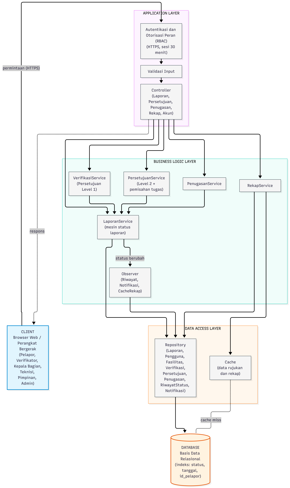

# Architecture - Nazwa Salwa Adellia | 2440304021

## Arsitektur: Layered

### Alasan memilih Layered Architecture
1.	Ruang lingkup sistem sudah jelas (mulai dari pelaporan hingga rekapitulasi) dengan beban P = 121 pengguna aktif. Layered Architecture sudah sangat mencukupi tanpa perlu kerumitan sistem terdistribusi.  
2.	Aturan persetujuan dua tingkat dipusatkan penuh di lapisan Business Logic. Hal ini menjamin aturan tidak dapat dimanipulasi atau dilompati, baik melalui antarmuka web maupun API luar.
3.	Masing-masing lapisan terisolasi (sesuai prinsip Dependency Inversion). Jika ada perubahan pada tampilan (UI) atau jenis basis data, logika bisnis inti tidak akan ikut rusak.   

### Fungsi tiap lapisan
| Lapisan | Fungsi | Komponen Utama |
|---|---|---|
| Client |	Menampilkan antarmuka dan mengirim permintaan |	Browser web, mobile web |
| Application |	Menerima permintaan, autentikasi, otorisasi berbasis peran, validasi input | Controller, RBAC, validator |
| Business Logic | Aturan bisnis: mesin status, dua tingkat persetujuan, pemisahan tugas, penerbitan notifikasi | Service, Observer |
| Data Access |	Akses data lewat repository, cache data rujukan dan rekap |	Repository, cache |
| Database | Penyimpanan permanen |	Basis data relasional |

### Aliran data utama
- Aliran 1: Aliran data pengajuan laporan baru diawali ketika pelapor mengisi formulir aduan pada antarmuka aplikasi. Permintaan ini diterima oleh Application Layer untuk diperiksa masa sesi login, otorisasi peran pengguna, serta kelengkapan isian formulir. Setelah terverifikasi valid, LaporanService di Business Logic Layer membuat entitas laporan baru bernomor tiket resmi dengan status awal DIAJUKAN, lalu meneruskannya ke Data Access Layer agar disimpan oleh Repository ke dalam basis data relasional. Proses ini kemudian secara otomatis memicu RiwayatObserver dan NotifikasiObserver untuk merekam jejak status serta mengirimkan konfirmasi nomor tiket kembali ke pelapor.   
- Aliran 2: Aliran data persetujuan Level 2 dimulai saat Kepala Bagian Sarpras memilih keputusan untuk menyetujui laporan pada dashboard. Application Layer terlebih dahulu memastikan bahwa pengguna terautentikasi memiliki peran KEPALA_SARPRAS. Selanjutnya, PersetujuanService memvalidasi tiga syarat utama: memastikan status laporan masih TERVERIFIKASI (lolos Level 1), memastikan pengguna saat ini bukan verifikator laporan tersebut demi mencegah rangkap jabatan, serta mengecek versi laporan guna menghindari bentrok data (optimistic locking). Jika seluruh syarat terpenuhi, status laporan diperbarui menjadi DISETUJUI, data keputusan tersimpan ke basis data, dan Observer dipicu untuk mengirimkan notifikasi perubahan status kepada pelapor dan verifikator.

### Cara menangani P = 121 pengguna aktif
Asumsi beban (konsisten dengan B2): beban normal ≈ 6 permintaan/detik, beban rancangan puncak ≈ 12 permintaan/detik.

| Aspek | Strategi | Argumentasi untuk P = 121  |
|---|---|---|
| Kapasitas aplikasi | Satu instance aplikasi dengan kumpulan thread terbatas (misalnya 8–16 worker); aplikasi dibuat stateless | Bila rata-rata pemrosesan ±200 ms, satu worker menangani ±5 permintaan/detik, sehingga 8 worker ≈ 40 permintaan/detik, jauh di atas 12. Angka ini asumsi rancangan, bukan hasil uji. |
| Koneksi basis data | Connection pool ukuran ±10–20 | Cukup untuk 121 sesi karena sebagian besar sesi menganggur di antara aksi. |
| Kueri | Indeks pada status, tanggal_lapor, id_pelapor; daftar dipaginasi (misalnya 20 baris) | Menjaga daftar laporan tetap cepat meski data bertambah. |
| Cache | Data rujukan (fasilitas, kategori) dan hasil rekap di-cache ±60 detik; dibatalkan oleh CacheRekapObserver saat status berubah | Rekap (FR-07) adalah kueri agregat paling berat, dan batas respons 5 detik di NFR-01 bisa dipenuhi. |
| Skalabilitas ke 2P (242) | Karena aplikasi stateless, tambah instance di belakang load balancer; basis data tetap satu | Memenuhi NFR-02 tanpa mengubah desain. Load balancer belum wajib pada P = 121, hanya disiapkan. |
| Konkurensi | Optimistic locking (versi di Laporan) | Dua orang memproses laporan yang sama: satu berhasil, satu mendapat pesan konflik. |
		
### Cara menangani constraint wajib (persetujuan dua tingkat)
| Kebutuhan NFR-06 | Mekanisme dalam arsitektur |
|---|---|
| Urutan wajib Level 1 → Level 2 | Mesin status di LaporanService: hanya transisi DIAJUKAN → TERVERIFIKASI → DISETUJUI yang diizinkan; transisi lain ditolak. |
| Hak akses per tingkat | Lapisan Application (RBAC) memeriksa peran sebelum permintaan menyentuh Business Logic; pemeriksaan ganda di PersetujuanService. |
| Pemisahan tugas | PersetujuanService menolak jika idPengguna sama dengan pemberi verifikasi laporan itu. |
| Jejak keputusan | Class Verifikasi, Persetujuan, dan RiwayatStatus menyimpan siapa, kapan, dan alasan. |
| Keputusan serentak | versi pada Laporan (optimistic locking). |